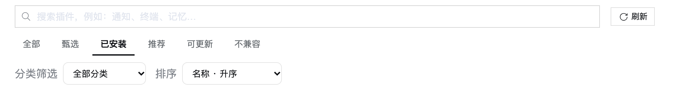
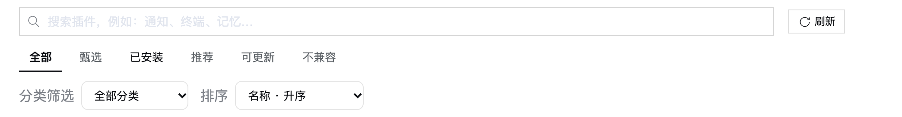
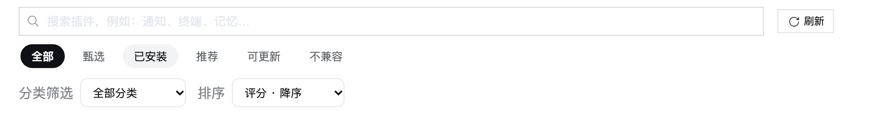
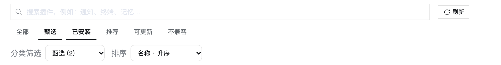
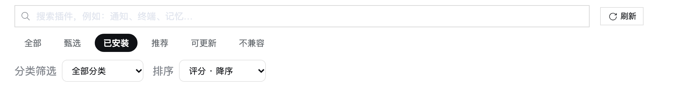
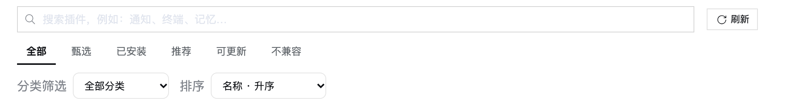
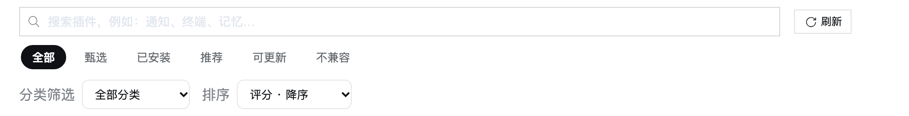
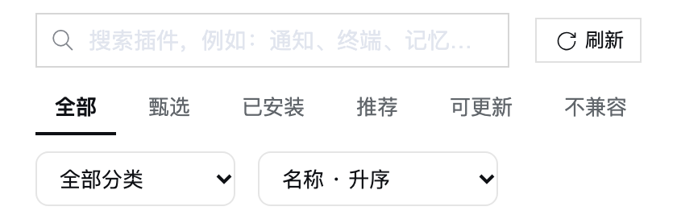
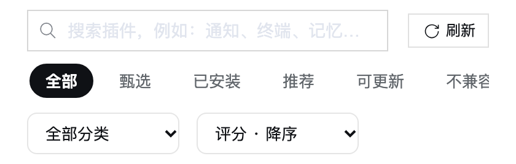

# issue #4 的交互与布局证据

对象：插件市场工具栏（状态筛选 chips · 分类筛选 · 甄选 · 排序）。基线 = `915dd66`（main），
改动 = 本分支。所有图片由仓库现成的截图探针渲染：**真实 host primitives**（从
`deepseek-harness` checkout 编译的 Button / Input / Modal / Toast）+ **真实
`client/client.js`**，经 `window.__ModuleLoader__` 与宿主相同的 facade 挂载，Chrome
headless 以 2x 截取。目录数据使用**合成 fixture**（6 个虚构条目 + 4 个分类 + ranking），
不含本机 profile 内容。

复现方式：`npm run build:client` → `node scripts/screenshots.mjs --harness
<deepseek-harness> --keep` 生成探针页，再用同一套 CDP 探针把 fixture 换成合成目录，并在
1044 / 420 两个宽度下用真实鼠标事件（move / press / release）截取点击前后的工具栏。
截图只裁工具栏区域，不包含卡片内容。

## 1. 点击态：从"下划线 + 文字变深"改为整块颜色

| 之前 | 之后 |
|---|---|
|  |  |
| 点击「已安装」后：与未选中 chip 同一个文字色，只有 2px 下划线 + 加粗 | 点击后整块填充 host accent（浅色 `rgb(15,17,21)` / 白色前景），其余 chip 保持透明 |

上面是「已安装」被选中且指针已移开的状态。选中之后指针再停到 chip 上，改动前后都**不再有**
额外的颜色变化：点击结果由选中色表达，不由 hover 表达（改动后选中色的填充与前景色都不随
hover/按下变化，也没有声明 transition）。

| 之前 hover（未选中） | 之后 hover（未选中） |
|---|---|
|  |  |
| 与「已选中」几乎同色（`rgb(15,17,21)`），只差下划线 —— 点完看起来像 hover 的残影 | 中性 6% 灰底（`rgba(38,49,72,.06)`），与实心选中的 accent 完全分开 |

计算样式（CDP `getComputedStyle`，1044px）：

| 状态 | before | after |
|---|---|---|
| 默认 | 透明底 / `rgb(97,102,107)` 文字 | 透明底 / 同 |
| hover | 透明底 / `rgb(15,17,21)` 文字 | `rgba(38,49,72,.06)` 底 / `rgb(15,17,21)` 文字 |
| 按下 | 透明底 / 同 hover | `rgba(38,49,72,.10)` 底 |
| 选中 | 透明底 / `rgb(15,17,21)` 文字 + 2px 下划线 | `rgb(15,17,21)` 实心底 / `rgb(255,255,255)` 文字 |
| 选中 + hover | 同选中（无变化） | 同选中（无变化，无 transition） |

## 2. 互斥选择：先点甄选，再点已安装

现场复现序列：先点「甄选」，再点「已安装」。之前两个 chip 会同时高亮（分类仍停在甄选），
现在状态 chip 与甄选 chip 互斥：点状态会清掉分类快捷选择，只剩「已安装」；反向从「已安装」点
「甄选」会把状态切回「全部」。「分类筛选」下拉仍可把分类叠加在当前状态视图上（AND），这是
下拉的既有能力，不与 chip 的互斥冲突。

| Before | After |
|---|---|
|  |  |
| pressed = 甄选、已安装；分类 = 甄选 | pressed = 已安装；分类 = 全部分类 |

## 3. 甄选：状态栏「全部」之后

现场确认的位置是状态栏：**全部 / 甄选 / 已安装 / 推荐 / 可更新 / 不兼容**。本 PR 的早期版本曾把
甄选移到分类控件行，收到反馈后改回状态栏第二项；下面是最终形态（同顺序、新 chip 样式）。

| 之前（1044） | 之后（1044） |
|---|---|
|  |  |
| 甄选本来就在状态行第二项，选中态是下划线 | 位置不变（全部、甄选、已安装、推荐、可更新、不兼容），点击态改为实心填充 |

| 之前（420，宿主对话框真实宽度） | 之后（420） |
|---|---|
|  |  |
| 同一顺序；分类与排序在下一行 | 顺序不变；分类框与排序仍同行、不重叠、不出框 |

分类与排序的几何（CDP `getBoundingClientRect`）：

```
420px  after: 分类框 right=252   排序 left=266   right=398  ≤ 420
380px  after: 分类框 right=212   排序 left=226   right=358  ≤ 380
```

## 4. 排序项

下拉是原生 `<select>`，它的弹出层不属于页面表面，无法用页面截图可靠记录；这里的证据是从
渲染后的 DOM 读出的选项表（点击 / 键盘操作使用同一列表）。

| 之前 | 之后 |
|---|---|
| 名称 · 升序 | 评分 · 降序（默认） |
| 名称 · 降序 | 评分 · 升序 |
| Star 数 · 降序 | Star 数 · 降序 |
| Star 数 · 升序 | Star 数 · 升序 |
| npm 下载量 · 降序 | 发布时间 · 降序 |
| npm 下载量 · 升序 | 发布时间 · 升序 |
| 发布时间 · 降序 | |
| 发布时间 · 升序 | |

默认值随之从 `name-asc` 变为 `score-desc`，因此在 `before-featured-1044.png` 与
`after-featured-1044.png` 的排序控件里也能看到「名称 · 升序」→「评分 · 降序」。
「推荐」仍是固定榜单视图，排序控件在该视图里隐藏。

## 5. Astryx 规范检查（可行性结论）

本机 Astryx 是 **Meta 的 React 19 组件库 + CLI**（`@astryxdesign/core` 0.7.11，
`@astryxdesign/cli` 0.7.11，demo 在 `~/Documents/AI/astryx`）。结论分两层：

- **不能用它的组件替换插件 UI**：这个面板渲染在 DSH 设置对话框里，交互控件由宿主注入的
  `@deepseek-ai/dsh-client-ui-primitives` 提供（React 18），而 Astryx 要求 React >= 19 且自带
  StyleX/主题层；引入等于在宿主里塞第二套设计系统，`astryx doctor` 也不能审计非 Astryx 工程
  （它检查的是 Astryx 项目的安装、主题和集成包）。
- **可以用它的评审规范做检查**：`astryx docs is-my-code-good` 的 rubric 明确要求"优先复用
  app 已有的 wrapper/integration，而不是因为和通用模式不同就改"，并要求每个结论都有渲染证据。
  按这个 rubric 检查本面板：

| rubric 类别 | 结果 | 依据 |
|---|---|---|
| App fit / task completion | good | 沿用宿主 primitives、设置面板密度与 token；420/380 下筛选与排序可完成 |
| Astryx components | 不适用（有意） | 宿主 primitives 就是本 app 的既定 wrapper；同上 |
| Icons | good | 图标走宿主注入的 icons，不直接画 SVG |
| Styling | 改前 needs work → 改后 good | 改前选中态与 hover 同色（本次修复）；颜色全部走 host alias token，无裸 hex |
| Layout | good | 三行固定布局；1044/420/380 实测同行、不重叠、不出框 |
| Accessibility | good | chip 用真实 `<button aria-pressed>`，`focus-visible` 有 2px outline；选中不只靠颜色（同时有 aria-pressed 与字重） |

`npx astryx doctor` 在本机 Astryx demo 上 11 pass / 0 fail，但它无法指向本插件仓库 —— 这是
"用 Astryx 规范检查"的边界，不是本插件的问题。

## 边界

- 截图使用合成目录；真实官网目录的卡片内容不在证据范围内。
- 原生 select 的弹出层未被截图，排序项以上表 + DOM 列表记录。
- 基线图片来自 `915dd66` 的 `client.js`，改动图片来自本分支构建；两者使用同一探针页、
  同一 fixture、同一 viewport 与主题（浅色）。
